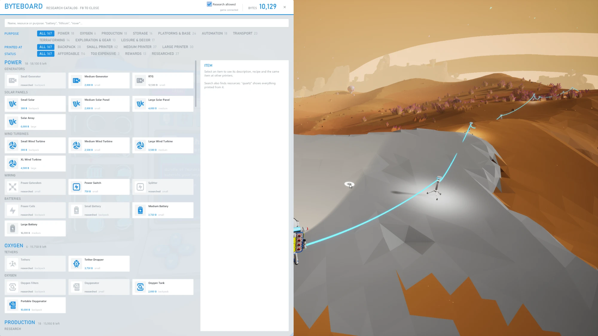
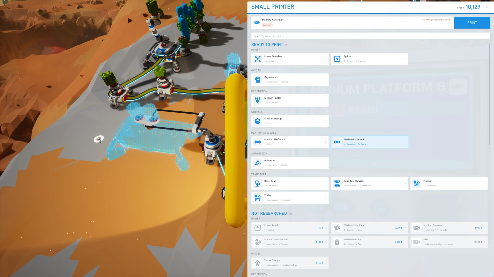
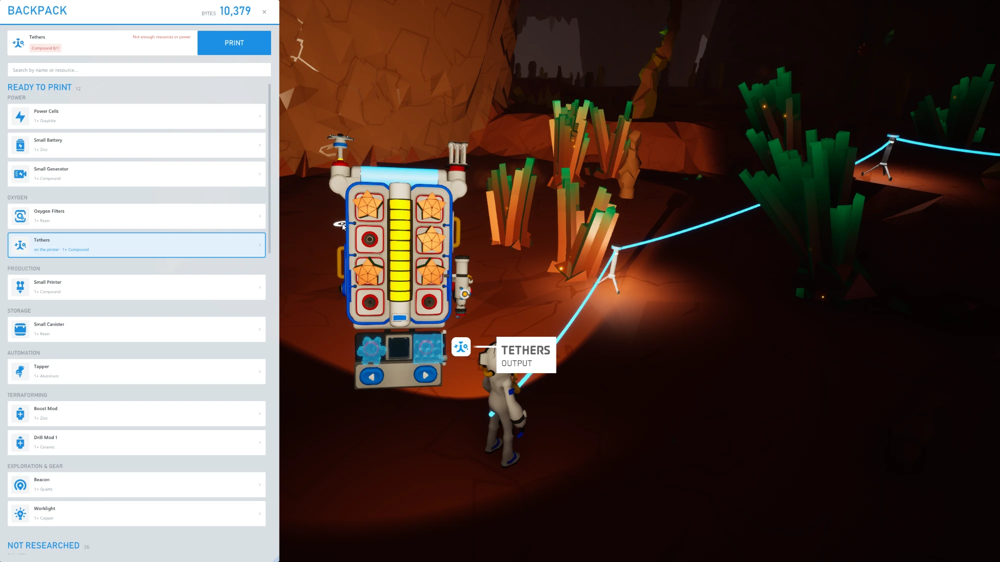

# Byteboard

**English** · [Русский](README.ru.md)

A better research and printer screen for ASTRONEER, drawn inside the game. The research catalog gets search,
purpose groups and filters, and research takes one click. Printers get a recipe list with recipe selection
and a Print button. The byte balance and the researched items are read live from the game.

It is a UE4SS Lua mod plus a Dear ImGui DirectX 11 overlay. The interface follows the game's language: English, Russian, German, Spanish, French, Italian, Dutch, Polish, Brazilian Portuguese and Turkish; other languages get English. Unofficial; no game
files are included.

> [!WARNING]
> **The code was written by an AI model (Claude by Anthropic) and has not been fully reviewed by a human.**
> It was tested in the game only in part. Use it at your own risk and back up your saves first.

| Printer list | Backpack |
|---|---|
|  |  |

## Compatibility

- ASTRONEER on Windows, DirectX 11; tested on 1.42.3 only (see [Tested](#tested)).
- Borderless or windowed mode is recommended; exclusive fullscreen has not been tested.
- [RE-UE4SS](https://github.com/UE4SS-RE/RE-UE4SS) experimental 3.0.1-1183-gcdbc0b66 or newer.
- Single-player only. On a multiplayer host the mod can take another player's printer panel, catalog or
  backpack for yours; recipe selection and the Print button can then act on that player's printer. On
  someone else's server it has not been tested.

## Tested

On ASTRONEER 1.42.3 (Unreal Engine 4.27) with RE-UE4SS experimental 3.0.1-1183, in single-player:

- install from the release archive and the game data extraction on the first start;
- the research catalog: search, filters, the item card and research;
- printer lists (backpack and printers): recipe selection and printing;
- items from missions, rails and expansion items in the catalog;
- the interface in English and Russian; the other languages were checked only outside the game.

Other game versions have not been tested. After a game update the mod reads the game data again, but an
update that changes the game's files or functions can break it.

## Features

- **Research catalog**: opens and closes together with the backpack research catalog.
  Search matches item and resource names in every supported language: "quartz" shows everything printed
  from it. Filters by purpose, printer and status. The item card shows the
  description, the recipe, every item of its subgroup across all printers (cheapest first) and a Research
  button.
- **Printer list**: appears when you open a printer panel. Items you can already print come first, items not
  yet researched below. Clicking a researched item selects its recipe on the printer; clicking one not yet
  researched opens it in the catalog. At the top: the current recipe, the ingredients at hand and a Print
  button.
- **Backpack (Q)**: a narrow list of the backpack printer's recipes.
- **Every printer item**, including rails, expansion items and mission rewards such as the VTOL and the
  hoverboard. A reward shows which mission gives it and cannot be bought for bytes.
- Window positions and sizes are saved in `Byteboard\out\overlay.ini`; to restore the defaults, delete the
  file while the game is closed.

## Install

1. Install [RE-UE4SS](https://github.com/UE4SS-RE/RE-UE4SS/releases) experimental 3.0.1-1183 or newer:
   [docs/INSTALL-UE4SS.md](docs/INSTALL-UE4SS.md).
2. Download `Byteboard-<version>.zip` from [Releases](https://github.com/Skycheeck/astroneer-byteboard/releases)
   and copy its `Byteboard` folder into `<game>\Astro\Binaries\Win64\ue4ss\Mods\`.
3. Start the game. The archive contains no game files: on the first start, and after each game update, the
   mod reads the item names, recipes and icons from your own copy of the game (a few seconds).

To build it yourself (Visual Studio 2022 or newer with the C++ x64 tools and "C++ CMake tools for Windows",
and Git), clone with `git clone --recurse-submodules https://github.com/Skycheeck/astroneer-byteboard.git`
and see [docs/DEVELOPMENT.md](docs/DEVELOPMENT.md).

## Safety

- Research spends bytes, so it runs only while the "Research allowed" checkbox in the
  catalog window is ticked (the checkbox creates the file `Byteboard\in\allow-unlock`). The mod asks the game to
  research an item with the same call the game's own catalog uses.
- Recipe selection and printing do not depend on the checkbox: they do what the printer's own buttons do.
- The mod does not write to saves and does not call the game's cheat functions. Items that exist only in
  Creative Mode (Aero, for example) cannot be researched.
- Before the first start with mods, make a copy of `%LOCALAPPDATA%\Astro\Saved\SaveGames`.

## Uninstall

Close the game and delete `ue4ss\Mods\Byteboard`. Items you researched stay researched in your save. To
remove UE4SS as well, see [docs/INSTALL-UE4SS.md](docs/INSTALL-UE4SS.md#uninstall).

## Troubleshooting

- Logs are in the mod folder: `out\events.log` (mod events), `out\commands.log` (commands and their
  results), `out\overlay.log` (the overlay and the game data extraction). `UE4SS.log` is in the game's
  `ue4ss` folder.
- If the mod folder has no `out` folder, the DLL did not load: `UE4SS.log` says why.
- If the overlay never appears, `overlay.log` says why, for example that a game update changed a file
  format the extraction reads.
- If the overlay hits an error while drawing a frame, it turns itself off until the game restarts and logs
  this in `overlay.log`; the game keeps running.

## How it works

The mod and the overlay never talk to each other directly: the mod writes the game state to
`out/state.json` in its folder once a second, and panel open/close signals and command results to other files
in `out/` as they happen; the overlay writes commands to `in/cmd.txt`. Details:

- [docs/ARCHITECTURE.md](docs/ARCHITECTURE.md): components, threads, safety rules;
- [docs/PROTOCOL.md](docs/PROTOCOL.md): the formats of all shared files;
- [docs/GAME-API.md](docs/GAME-API.md): which game functions are used;
- [docs/DEVELOPMENT.md](docs/DEVELOPMENT.md): building, previews without the game, checks.

## License

[MIT](LICENSE). Third-party components: [THIRD_PARTY_NOTICES.md](THIRD_PARTY_NOTICES.md).

ASTRONEER is a trademark of System Era Softworks. This project is unofficial and not affiliated with System
Era Softworks. The files the mod writes into its `data` folder contain game data: do not publish them.
