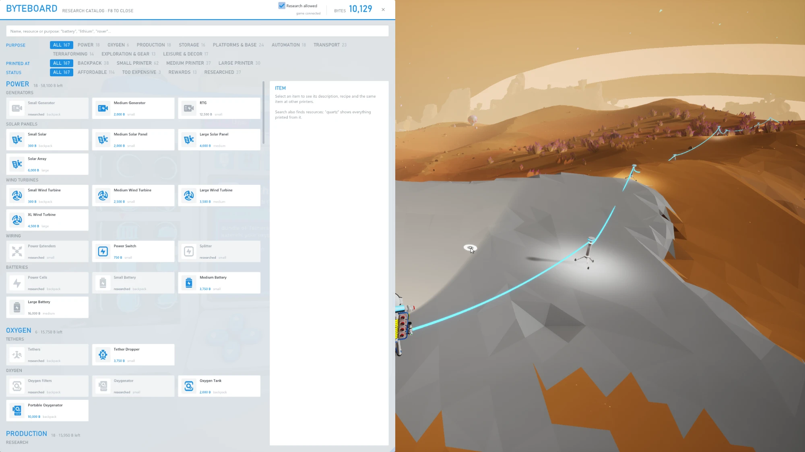
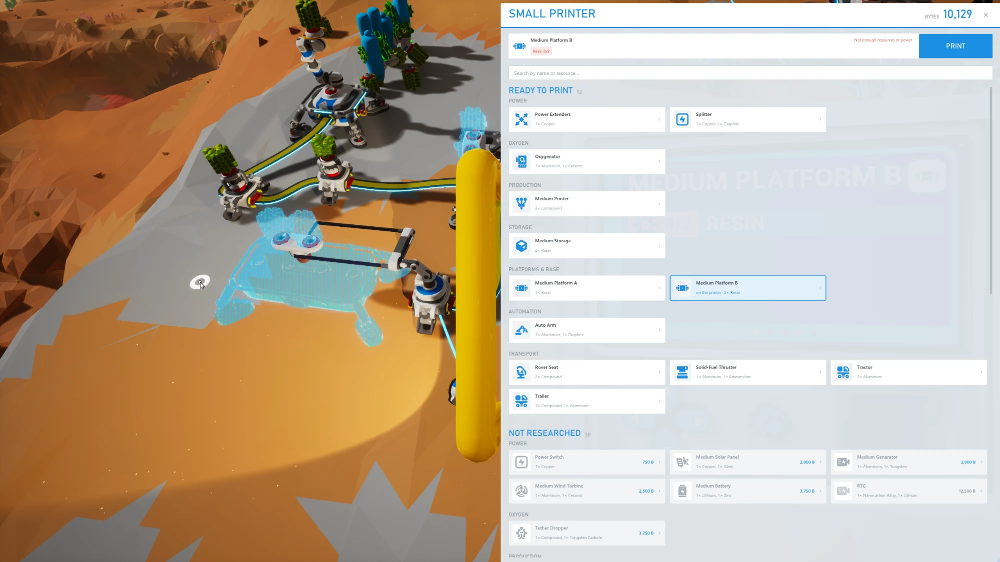
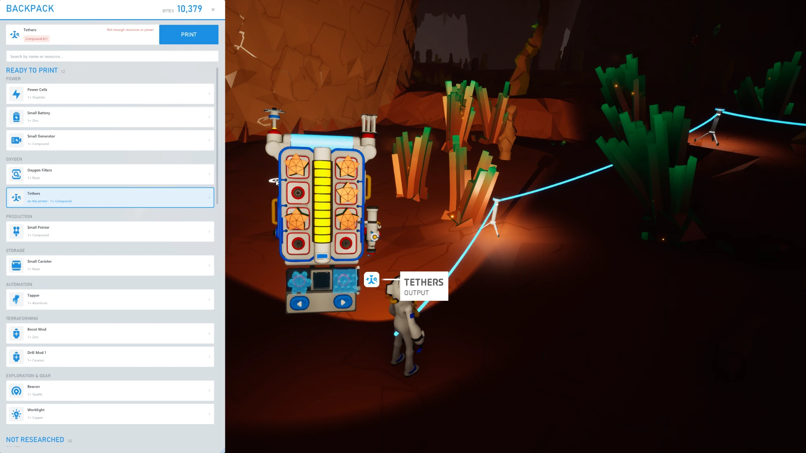

# Byteboard

[English](README.md) · **Русский**

Удобный экран исследований и печати для ASTRONEER прямо в игре. Каталог исследований с поиском, группами по
назначению и фильтрами; изучение в один клик; список рецептов принтера с выбором рецепта и кнопкой
«Печатать». Баланс байтов и изученное берутся из игры вживую.

Это Lua-мод для UE4SS и оверлей на Dear ImGui (DirectX 11). Язык интерфейса — как в игре: русский, английский, немецкий, испанский, французский, итальянский, нидерландский, польский, бразильский португальский или турецкий; при других языках — английский. Проект неофициальный,
файлов игры в нём нет.

> [!WARNING]
> **Код написан нейросетью (Claude от Anthropic) и полностью человеком не проверялся.**
> В игре он проверен лишь частично. Используйте на свой риск и сначала сделайте копию сохранений.

| Список принтера | Рюкзак |
|---|---|
|  |  |

## Совместимость

- ASTRONEER на Windows, DirectX 11; проверено только на 1.42.3 (см. [Что проверено](#что-проверено)).
- Рекомендуется режим «без рамки» или в окне; эксклюзивный полноэкранный режим не проверялся.
- [RE-UE4SS](https://github.com/UE4SS-RE/RE-UE4SS) experimental 3.0.1-1183-gcdbc0b66 или новее.
- Только одиночная игра. На хосте сетевой игры мод может принять панель принтера, каталог или рюкзак
  другого игрока за ваши, и тогда выбор рецепта и кнопка «Печатать» могут сработать на его принтере. На
  чужом сервере мод не проверялся.

## Что проверено

На ASTRONEER 1.42.3 (Unreal Engine 4.27) с RE-UE4SS experimental 3.0.1-1183, в одиночной игре:

- установка из архива релиза и чтение данных игры при первом запуске;
- каталог исследований: поиск, фильтры, карточка предмета и изучение;
- списки принтеров (рюкзак и принтеры): выбор рецепта и печать;
- награды за задания, рельсы и предметы дополнений в каталоге;
- интерфейс на английском и русском; остальные языки проверены только вне игры.

Другие версии игры не проверялись. После обновления игры мод заново читает её данные, но обновление,
которое меняет файлы или функции игры, может его сломать.

## Возможности

- **Каталог исследований** открывается и закрывается вместе с каталогом исследований рюкзака.
  Поиск ищет по названиям предметов и ресурсов на всех этих языках: «кварц» покажет всё,
  что из него печатается. Фильтры по назначению, принтеру и статусу. Карточка предмета: описание, рецепт,
  все предметы его подгруппы со всех принтеров (от дешёвых к дорогим) и кнопка «Изучить».
- **Список принтера** появляется, когда вы открываете панель принтера: сначала то, что уже можно печатать,
  ниже неизученное. Клик по изученному предмету выбирает его рецепт на принтере, клик по неизученному
  открывает его в каталоге. Сверху текущий рецепт, наличие ингредиентов и кнопка «Печатать».
- **Рюкзак (Q)**: узкий список рецептов принтера рюкзака.
- **Все предметы принтеров**, включая рельсы, предметы дополнений и награды за задания (СВВП, ховерборд).
  У награды указано, какое задание её даёт; за байты она не изучается.
- Положение и размер окон запоминаются в `Byteboard\out\overlay.ini`; чтобы вернуть умолчание, удалите
  файл при закрытой игре.

## Установка

1. Поставьте [RE-UE4SS](https://github.com/UE4SS-RE/RE-UE4SS/releases) experimental 3.0.1-1183 или новее:
   [docs/INSTALL-UE4SS.md](docs/INSTALL-UE4SS.md) (на английском).
2. Скачайте `Byteboard-<версия>.zip` из [Releases](https://github.com/Skycheeck/astroneer-byteboard/releases)
   или с [Nexus Mods](https://www.nexusmods.com/astroneer/mods/244)
   и скопируйте папку `Byteboard` из архива в `<папка игры>\Astro\Binaries\Win64\ue4ss\Mods\`.
3. Запустите игру. Файлов игры в архиве нет: при первом запуске и после каждого обновления игры мод сам
   читает названия, рецепты и иконки из вашей копии игры (несколько секунд).

Чтобы собрать мод самому (Visual Studio 2022 или новее с инструментами C++ x64 и компонентом «Средства CMake
C++ для Windows», плюс Git), клонируйте репозиторий командой
`git clone --recurse-submodules https://github.com/Skycheeck/astroneer-byteboard.git` и смотрите
[docs/DEVELOPMENT.md](docs/DEVELOPMENT.md) (на английском).

## Безопасность

- Изучение тратит байты и поэтому выполняется, только пока отмечена галочка «Изучение разрешено» в окне
  каталога (она создаёт файл `Byteboard\in\allow-unlock`). Мод просит игру изучить предмет тем же вызовом,
  что и родной каталог.
- Выбор рецепта и печать от галочки не зависят: они делают то же, что кнопки самого принтера.
- Мод не пишет в сохранения и не вызывает читерские функции игры. Предметы только для творческого режима
  (например «Аэро») изучить нельзя.
- Перед первым запуском с модами сделайте копию `%LOCALAPPDATA%\Astro\Saved\SaveGames`.

## Удаление

Закройте игру и удалите папку `ue4ss\Mods\Byteboard`. Изученное в сохранении остаётся. Как удалить
и UE4SS: [docs/INSTALL-UE4SS.md](docs/INSTALL-UE4SS.md#uninstall).

## Если что-то не работает

- Логи лежат в папке мода: `out\events.log` — события мода, `out\commands.log` — команды и их
  результаты, `out\overlay.log` — оверлей и выгрузка данных игры. `UE4SS.log` лежит в папке `ue4ss` игры.
- Если в папке мода нет папки `out`, DLL не загрузилась: причина записана в `UE4SS.log`.
- Если оверлей так и не появился, причина записана в `overlay.log`: например, обновление игры изменило
  формат файлов, которые читает выгрузка.
- Если оверлей поймал ошибку в своём кадре, он отключается до перезапуска игры и пишет об этом в
  `overlay.log`; игра продолжает работать.

## Как это устроено

Мод и оверлей не связаны напрямую: мод раз в секунду пишет состояние игры в `out/state.json` в своей папке,
а сигналы об открытии и закрытии панелей и результаты команд пишет в другие файлы `out/` сразу, как они
появляются; оверлей пишет команды в `in/cmd.txt`. Подробности (на английском):

- [docs/ARCHITECTURE.md](docs/ARCHITECTURE.md) — компоненты, потоки, правила безопасности;
- [docs/PROTOCOL.md](docs/PROTOCOL.md) — форматы всех общих файлов;
- [docs/GAME-API.md](docs/GAME-API.md) — какие функции игры используются;
- [docs/DEVELOPMENT.md](docs/DEVELOPMENT.md) — сборка, предпросмотр без игры, проверки.

## Лицензия

[MIT](LICENSE). Сторонние компоненты: [THIRD_PARTY_NOTICES.md](THIRD_PARTY_NOTICES.md).

ASTRONEER — торговая марка System Era Softworks. Проект неофициальный и не связан с System Era Softworks.
Файлы, которые мод пишет в свою папку `data`, содержат данные игры: не публикуйте их.
